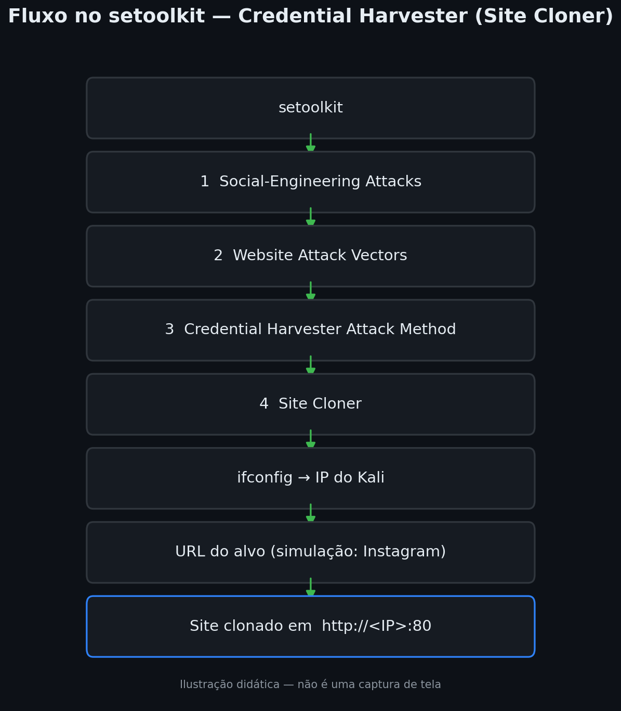
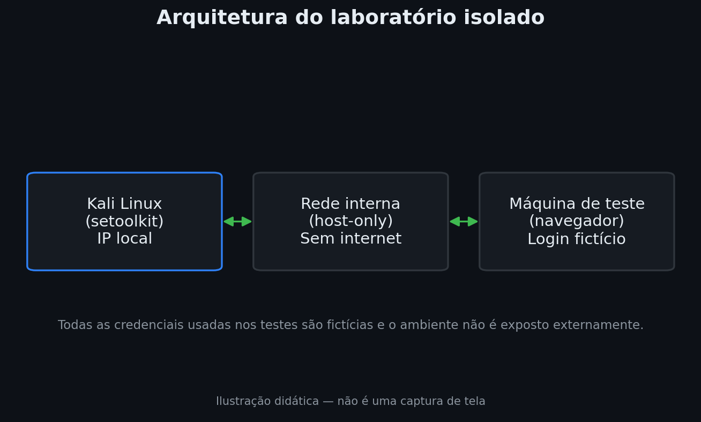
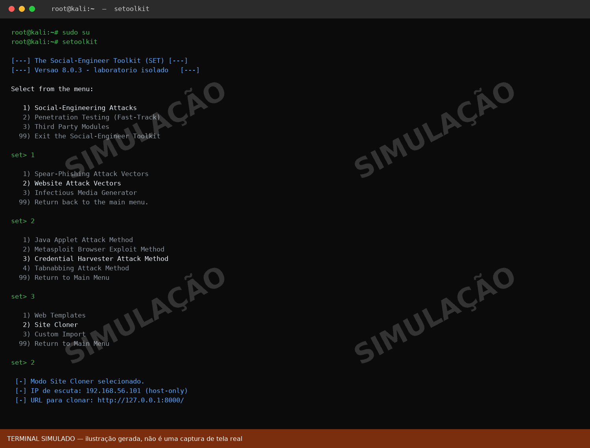
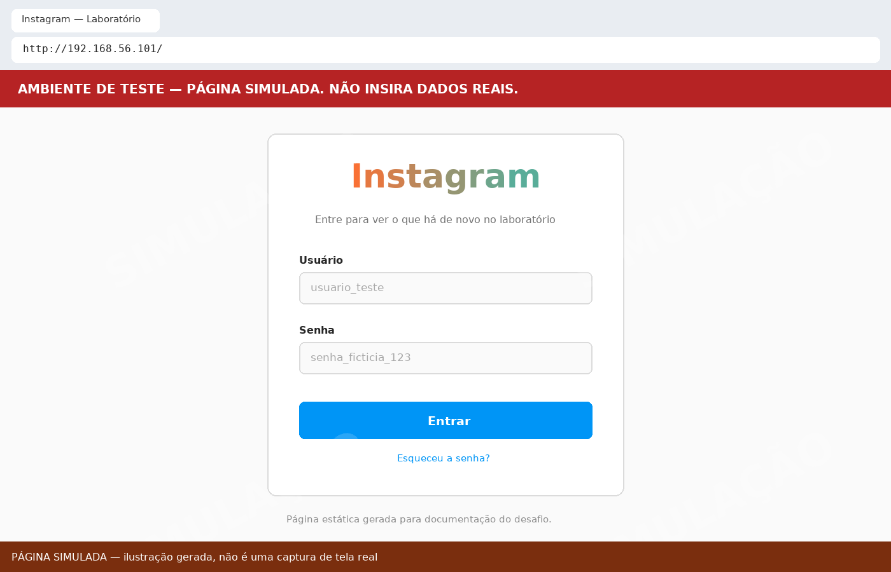
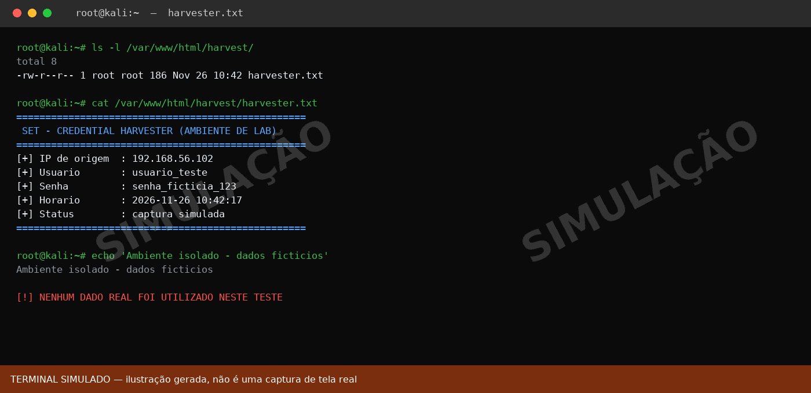

# 🔐 Desafio de Cybersegurança — Phishing com SET (Instagram simulado)

> ⚠️ **Aviso ético:** este projeto é **exclusivamente educacional**. Todo o experimento
> foi realizado em laboratório isolado, com rede host-only e **credenciais fictícias**.
> O objetivo é entender como funciona um ataque de engenharia social para saber
> reconhecê-lo e defendê-lo — nunca replicá-lo contra pessoas ou serviços reais.

---

## Sumário

- [Entendendo o Desafio](#entendendo-o-desafio)
- [Descrição do Desafio](#descrição-do-desafio)
- [Objetivos de Aprendizagem](#objetivos-de-aprendizagem)
- [Ambiente e ferramentas](#ambiente-e-ferramentas)
- [Metodologia](#metodologia)
- [Evidências (prints)](#evidências-prints)
- [Entrega do Desafio](#entrega-do-desafio)
- [Estrutura do repositório](#estrutura-do-repositório)

---

## Entendendo o Desafio

Agora é a sua hora de brilhar e construir um perfil de destaque na DIO! A proposta aqui
é ir além: você poderá recriar do zero ou aperfeiçoar o projeto original desenvolvido
pelo instrutor. Para isso, dê um fork no repositório-base ou crie o seu próprio
repositório, colocando em prática tudo o que aprendeu até agora.

## Descrição do Desafio

Este projeto tem como objetivo utilizar a ferramenta **setoolkit** para criar uma página
falsa do Facebook para captura de senhas.

> **Adaptação realizada:** o repositório de referência clona `http://www.facebook.com`.
> Nesta versão, o exercício foi adaptado para um **site simulado do Instagram**,
> hospedado localmente no laboratório. Assim é possível estudar o fluxo do ataque sem
> interagir com um serviço real nem expor dados de terceiros.

## Objetivos de Aprendizagem

Ao concluir este desafio, você será capaz de:

- Aplicar os conceitos aprendidos em um cenário real;
- Documentar seu raciocínio técnico e decisões de forma clara e organizada;
- Utilizar o GitHub como plataforma para versionamento e exposição do seu trabalho.

---

## Ambiente e ferramentas

| Item | Função |
| --- | --- |
| Kali Linux (máquina virtual) | Sistema do laboratório, com o `setoolkit` instalado |
| `setoolkit` | Ferramenta de engenharia social usada para clonar a página e coletar o envio do formulário |
| Rede host-only | Mantém o servidor isolado do mundo externo |
| Navegador na máquina de teste | Cliente que acessa a página simulada pelo IP do Kali |
| Python (`http.server`) | Opcional: servir a página simulada do Instagram localmente |

```bash
# Clonar este repositório no Kali Linux
git clone https://github.com/<seu-usuario>/<seu-repositorio>.git
cd <seu-repositorio>
```

---

## Metodologia

### 1. Preparar o ambiente

```bash
sudo su
ifconfig        # ou: ip a  → descubra o IP da VM do Kali
```

Antes de iniciar, confirme que a VM está em **rede isolada (host-only)**.

### 2. Servir a página simulada do Instagram (opcional)

Caso queira usar uma página própria em vez de um site público:

```bash
mkdir -p site_simulado
# coloque os arquivos HTML/CSS da página simulada em site_simulado/
cd site_simulado
python3 -m http.server 8000
```

A página ficará disponível em `http://127.0.0.1:8000`.

### 3. Navegar no setoolkit

```bash
setoolkit
```

Sequência de menus (ilustrada no diagrama abaixo):

| Etapa | Opção escolhida |
| --- | --- |
| Tipo de ataque | `Social-Engineering Attacks` |
| Vetor de ataque | `Web Site Attack Vectors` |
| Método de ataque | `Credential Harvester Attack Method` |
| Método de clonagem | `Site Cloner` |
| Endereço de escuta | IP retornado por `ifconfig` |
| URL a clonar | `http://127.0.0.1:8000` (página simulada do Instagram) |



> Figura 1 — diagrama didático gerado (não é uma captura de tela). O fluxo segue o
> mesmo caminho documentado no repositório-base, trocando apenas a URL clonada.

### 4. Testar e registrar

Acesse `http://<IP-do-Kali>` na máquina de teste, envie o formulário com **dados
fictícios** e registre o resultado nos arquivos de evidência.



> Figura 2 — topologia do laboratório: o servidor do setoolkit não é exposto à internet.

### 5. Encerrar

Ao final, interrompa o `setoolkit` (`Ctrl + C`), pare o servidor HTTP e desligue a VM.

---

## Evidências (prints)

Como não havia Kali Linux disponível no ambiente de desenvolvimento, as telas abaixo
foram **geradas artificialmente** por `python images/gerar_diagramas.py`. Elas
reproduzem visualmente o fluxo esperado e trazem uma identificação visível
(`SIMULAÇÃO GERADA`) para não serem confundidas com capturas autênticas. Se você
depois executar o laboratório de fato, basta sobrescrever os arquivos com os prints
reais (checklist em [`images/README.md`](./images/README.md)).

> ⚠️ Todas as credenciais exibidas são fictícias (`usuario_teste` /
> `senha_ficticia_123`) e os IPs são de rede host-only.

| Evidência | O que representa | Situação |
| --- | --- | --- |
| [03-menu-setoolkit.png](./images/03-menu-setoolkit.png) | Menu do setoolkit com as opções selecionadas | Simulação gerada |
| [04-site-simulado.png](./images/04-site-simulado.png) | Página simulada do Instagram servida no IP do Kali | Simulação gerada |
| [05-credenciais-capturadas.png](./images/05-credenciais-capturadas.png) | Arquivo de credenciais com dados fictícios | Simulação gerada |





---

## Entrega do Desafio

Para concluir este desafio, você deverá:

### Assistir a todas as vídeo-aulas

Não pule nenhuma etapa! As aulas contêm informações essenciais para o sucesso do seu projeto.

### Criar um repositório público no GitHub contendo:

- Um arquivo `README.md` detalhado;
- Qualquer outro arquivo relevante para a compreensão do projeto;
- Opcionalmente, capturas de tela relevantes organizadas em uma pasta `/images`.

### Enviar o link do seu repositório e uma breve descrição clicando no botão “Entregar Projeto”

---

## Estrutura do repositório

```text
.
├── README.md                       # documentação do desafio
├── images/
│   ├── README.md                   # checklist dos prints a capturar
│   ├── gerar_diagramas.py          # script que gera diagramas e simulacoes
│   ├── 01-fluxo-setoolkit.png      # diagrama gerado
│   ├── 02-arquitetura-lab.png      # diagrama gerado
│   ├── 03-menu-setoolkit.png       # simulacao do terminal do setoolkit
│   ├── 04-site-simulado.png        # simulacao da pagina do Instagram
│   └── 05-credenciais-capturadas.png  # simulacao do arquivo de credenciais
└── passwd.png                      # evidência original do repo-base (Facebook)
```

## Referências

- Documentação oficial do [Social-Engineer Toolkit (SET)](https://github.com/trustedsec/social-engineer-toolkit)
